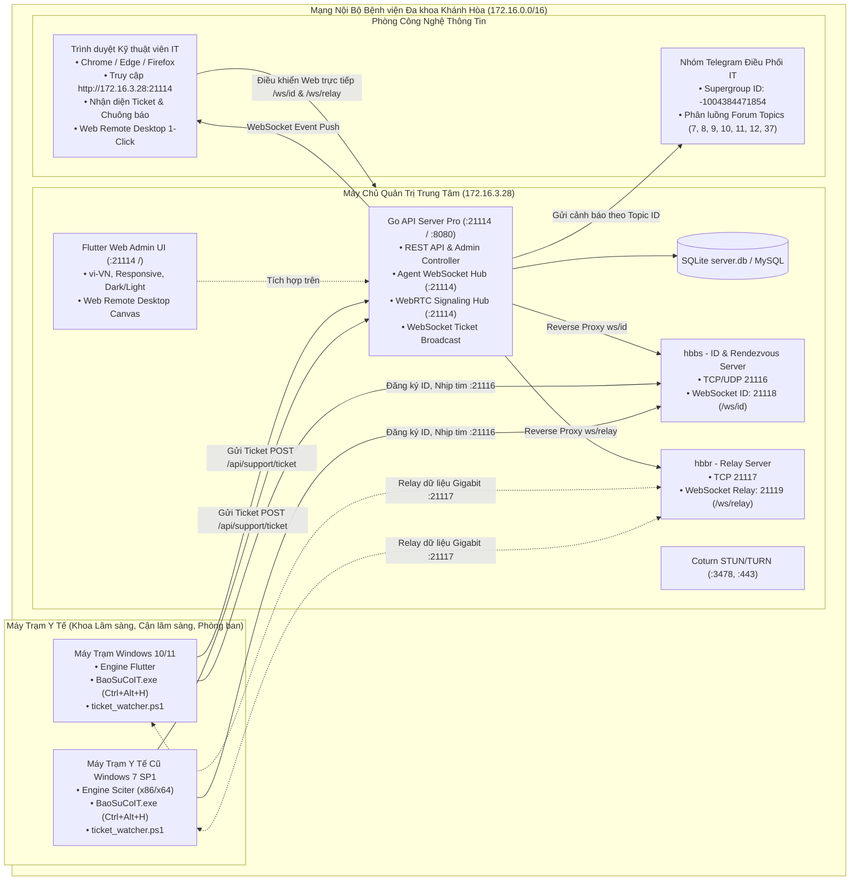
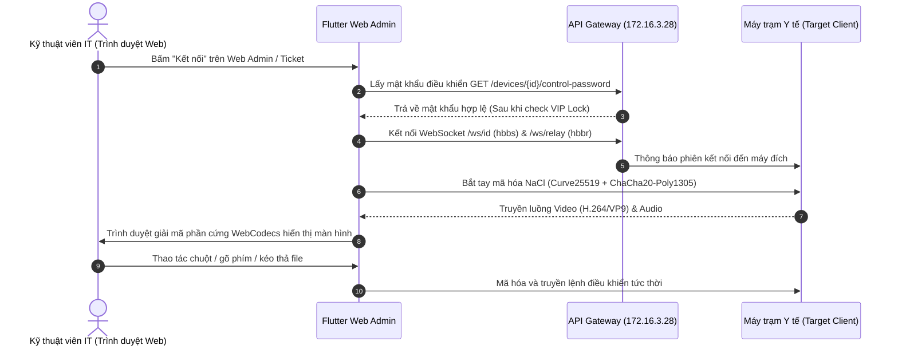

# BÁO CÁO KHẢO SÁT HỆ THỐNG MÁY CHỦ QUẢN TRỊ & CỔNG WEB ADMIN
## Hệ thống Điều Khiển Từ Xa & Tiếp Nhận Sự Cố IT Nội Bộ — "BVĐKKH - Remote"
**Đơn vị thực hiện:** explorer_survey_2  
**Thời gian khảo sát:** 2026-10-06  
**Phạm vi khảo sát:** Backend Go (RustDesk API Server Pro), Cơ sở dữ liệu, Cổng Flutter Web Admin (`rustdesk_admin`), Web Remote Desktop, Sổ địa chỉ Address Book, Phân nhóm Khoa Phòng, Quản lý Ticket Sự cố WebSocket, Điều phối Telegram Bot theo Topic.

---

## 1. TỔNG QUAN KIẾN TRÚC & MẠNG NỘI BỘ (ON-PREMISE TOPOLOGY)

### 1.1. Địa chỉ Triển khai & Triết lý Thiết kế
Toàn bộ hệ thống máy chủ điều khiển và quản trị "BVĐKKH - Remote" được cấu hình chạy tập trung **On-Premise 100% trong mạng LAN nội bộ Bệnh viện Đa khoa Khánh Hòa**, tại địa chỉ IP máy chủ:
* **Địa chỉ IP Máy chủ Quản trị:** `172.16.3.28`
* **Môi trường:** Docker Container / Linux Host, phân mạng y tế bảo mật, cách ly hoàn toàn với rủi ro rò rỉ dữ liệu qua Internet.
* **Cơ chế hoạt động:** Máy trạm (Clients) kết nối trực tiếp đến IP `172.16.3.28` để định danh ID, đồng bộ danh bạ, gửi tín hiệu nhịp tim (heartbeat), tạo ticket báo sự cố và thiết lập luồng điều khiển P2P/Relay mạng nội bộ băng thông Gigabit.



---

### 1.2. Bảng Ma Trận Cổng Kết Nối Toàn Hệ Thống (Port Matrix)
Các thông số cổng được trích xuất chính xác 100% từ các tệp cấu hình nguồn: `rustdesk-api-server-pro/backend/server.yaml`, `rustdesk-api-server-pro/backend/app/main.go`, `rustdesk-api-server-pro/docs/PORTS.md`, `rustdesk/src/common.rs`, `CaiDat/cai_dat.bat`:

| Cổng (Port) | Giao thức | Dịch vụ tương ứng | File mã nguồn tham chiếu | Chức năng kỹ thuật trong hệ thống |
|:---:|:---:|:---|:---|:---|
| **21114** | TCP (HTTP) | **RustDesk API Server Pro & Web Admin** | `backend/server.yaml`<br/>`backend/app/main.go:191`<br/>`ticket_watcher.ps1:9` | Cung cấp toàn bộ REST API quản trị, API tiếp nhận sự cố máy trạm (`/api/support/ticket`), Agent WebSocket (`/api/agent/deployment/ws`), WebRTC Signaling (`/api/webrtc/signal`) và phục vụ mã nguồn tĩnh Flutter Web Admin (`/`). |
| **21115** | TCP | **RustDesk NAT Traversal Test** | `rustdesk/src/common.rs`<br/>`docs/PORTS.md` | Dùng cho máy trạm kiểm tra kiểu NAT (Full cone / Symmetric) để tối ưu kết nối P2P trực tiếp. |
| **21116** | TCP / UDP | **hbbs (Rendezvous & ID Server)** | `CaiDat/cai_dat.bat:300, 770`<br/>`rustdesk/src/common.rs:137` | Cổng chính đăng ký máy trạm, duy trì nhịp tim kết nối (Heartbeat TCP), phân giải ID và điều phối kết nối P2P (UDP). Script cài đặt kiểm tra cổng này để xác nhận thông mạng. |
| **21117** | TCP | **hbbr (Relay Server)** | `CaiDat/cai_dat.bat:770`<br/>`floating_session_manager.dart:75` | Cổng trung chuyển dữ liệu hình ảnh/âm thanh khi 2 máy trạm khác dải VLAN không thể thông mạng P2P trực tiếp. Băng thông Gigabit nội viện. |
| **21118** | TCP (WS) | **hbbs WebSocket ID Server** | `backend/app/main.go:147-153` | Cổng WebSocket của hbbs phục vụ Web Remote Desktop, được API Server reverse-proxy qua đường dẫn `/ws/id`. |
| **21119** | TCP (WS) | **hbbr WebSocket Relay Server** | `backend/app/main.go:155-161` | Cổng WebSocket của hbbr phục vụ Web Remote Desktop, được API Server reverse-proxy qua đường dẫn `/ws/relay`. |
| **3478** | UDP / TCP | **Coturn STUN / TURN** | `backend/app/controller/api/webrtc.go:59`<br/>`remote_unified_deploy_docker-compose.yaml:307` | Hỗ trợ dò tìm ứng viên mạng (ICE Candidates) và trung chuyển media WebRTC khi điều khiển trực tiếp trên trình duyệt Web. |
| **443** | TCP (TLS) | **Coturn TURNS Server** | `backend/app/controller/api/webrtc.go:66` | Cổng dự phòng bảo mật cho WebRTC qua TLS khi các cổng khác bị chặn tường lửa. |

---

## 2. PHÂN HỆ BACKEND: RUSTDESK API SERVER PRO (GO ENGINE)

### 2.1. Cấu trúc Công nghệ & Khởi tạo Dịch vụ
* **Ngôn ngữ & Framework:** Go 1.21+, sử dụng framework web hiệu năng cao **Iris v12** (`github.com/kataras/iris/v12`), ORM **XORM** (`xorm.io/xorm`), lập lịch nền **gocron v2** (`github.com/go-co-op/gocron/v2`).
* **Điểm khởi chạy:** `rustdesk-api-server-pro/backend/app/main.go`
* **Cơ chế định tuyến (Route Registration):** `rustdesk-api-server-pro/backend/app/route.go`
  * Phân vùng công khai (Public): `/api/system`, `/api/login`, `/api/support/ticket`, `/api/webrtc/ice-servers`, `/ws/agent`, `/api/webrtc/signal`.
  * Phân vùng xác thực Client (`ApiAuth`): `/api/users`, `/api/peers`, `/api/ab` (Address Book), `/api/device-groups`, `/api/enterprise_compat`.
  * Phân vùng quản trị viện (`AdminAuth`): `/admin/dashboard`, `/admin/devices`, `/admin/support/tickets`, `/admin/device-groups`, `/admin/users`, `/admin/sessions`, `/admin/audit`, `/admin/settings`.
* **Cơ chế Reverse Proxy Zero-Latency WebSocket (`main.go:115-162`):**
  * Tích hợp `httputil.NewSingleHostReverseProxy` với thông số `FlushInterval = -1` (flush dữ liệu lập tức, triệt tiêu độ trễ đệm buffer) chuyển tiếp gói tin WebSocket từ `/ws/id` vào `rustdesk-hbbs:21118` và từ `/ws/relay` vào `rustdesk-hbbr:21119`.
  * Thiết lập Header COOP/COEP (`Cross-Origin-Opener-Policy: same-origin`, `Cross-Origin-Embedder-Policy: credentialless`) để hỗ trợ WebAssembly đa luồng (Skwasm Web Workers) trên trình duyệt.

### 2.2. Cơ sở Dữ liệu & Mô hình Dữ liệu Chi tiết (Database Models)
Cấu hình tại `backend/server.yaml`:
```yaml
db:
  driver: "sqlite"
  dsn: "./server.db"
  timeZone: "Asia/Ho_Chi_Minh"
  showSql: false
```
Hệ thống sử dụng **SQLite** lưu trữ cục bộ độc lập (hoặc kết nối **MySQL** qua DSN dự phòng), chuẩn múi giờ Việt Nam `Asia/Ho_Chi_Minh`.

#### Danh sách các Bảng Dữ liệu Cốt lõi:
1. **Bảng `device` (`backend/app/model/device.go`):** Quản lý toàn bộ danh sách máy trạm trong viện.
   * `id`: Khóa chính tự tăng.
   * `rustdesk_id` (`varchar(255)`): ID 9 chữ số của máy trạm.
   * `hostname`, `username`, `os`, `cpu`, `memory`: Cấu hình phần cứng và hệ điều hành.
   * `uuid` (`varchar(255)`): Mã định danh duy nhất chống trùng lặp.
   * `is_online` (`bool`): Trạng thái trực tuyến thực tế.
   * `network_info` (`text`): JSON cấu trúc các card mạng, MAC và danh sách IP.
   * `hardware_info` (`text`): JSON chi tiết ổ đĩa, RAM, thiết bị ngoại vi.
   * `allow_auto_password` (`bool default true`): Cho phép tự động điền mật khẩu điều khiển.
   * `is_vip` (`bool default false`): Cờ đánh dấu thiết bị bảo mật cao / VIP.
   * `note` (`text`): Ghi chú khoa phòng / người dùng.

2. **Bảng `device_admin_access` (`backend/app/model/device_admin_access.go`):** Phân quyền truy cập VIP đa tầng.
   * `id`: Khóa chính.
   * `rustdesk_id` (`varchar(255)`): Liên kết ID máy VIP.
   * `user_id` (`int`): ID tài khoản Admin được Super Admin cấp phép điều khiển.

3. **Bảng `support_ticket` (`backend/app/model/support_ticket.go`):** Hệ thống Ticket báo sự cố HelpDesk.
   * `id` (`bigint pk autoincr`): Mã phiếu sự cố.
   * `device_id` (`varchar(255) index`): RustDesk ID máy gặp sự cố.
   * `hostname`, `username`, `ip_address`, `os`: Thông tin môi trường máy trạm gửi kèm.
   * `category` (`varchar(100)`): Danh mục sự cố chuẩn hóa (`his_lis`, `printer`, `network`, `slow_pc`, `software_install`, `hardware_other`).
   * `priority` (`varchar(32)`): Mức độ khẩn cấp (`normal`, `urgent`).
   * `description` (`text`): Nội dung mô tả sự cố từ nhân viên y tế.
   * `contact_name` (`varchar(100)`), `contact_phone` (`varchar(50)`): Cán bộ yêu cầu.
   * `logs` (`text`): Trích xuất 50 dòng log hệ thống gần nhất tự động đính kèm.
   * `status` (`varchar(32) index`): Vòng đời ticket (`open`, `assigned`, `in_progress`, `resolved`, `closed`).
   * `assigned_admin` (`varchar(100)`), `assigned_at` (`datetime`): Kỹ thuật viên IT nhận việc.
   * `started_at`, `ended_at`, `duration_seconds`: Thời gian bắt đầu và kết thúc xử lý.
   * `resolution_note` (`text`): Ghi chú kết quả xử lý của KTV.

4. **Bảng Sổ Địa Chỉ & Phân Nhóm:**
   * `address_book` (`backend/app/model/address_book.go`): Quản lý sổ địa chỉ tập trung theo tài khoản hoặc dùng chung (`shared: true`).
   * `peer` (`backend/app/model/peer.go`): Chi tiết từng nút thiết bị trong danh bạ, lưu mật khẩu điều khiển mã hóa (`password`), bí danh (`alias`), nhãn (`tags`), cờ `is_vip`.
   * `address_book_tag` & `tags` (`backend/app/model/tags.go`): Nhãn màu sắc phân loại thiết bị.
   * `device_group` & `device_group_device` (`backend/app/model/enterprise_compat.go`): Quản lý cơ cấu Khoa / Phòng / Trung tâm của bệnh viện.

5. **Bảng `user` (`backend/app/model/user.go`):**
   * Quản lý tài khoản KTV IT: `username`, `password` (bcrypt), `is_admin`, `is_super_admin`, `tfa_secret` (xác thực 2 bước Google Authenticator / TOTP).

6. **Bảng `wol_log` (`backend/app/model/wol.go`):** Nhật ký đánh thức máy qua mạng LAN (Wake-on-LAN), theo dõi địa chỉ MAC, máy trung gian (relay device), thời gian máy khởi động (`boot_duration_sec`).

---

### 2.3. Các Tiến Trình Chạy Ngầm Tự Động (Background Daemons / Cron Jobs)
Được cấu hình và kích hoạt tại `rustdesk-api-server-pro/backend/app/jobs.go`:
1. **Tiến trình Quét Trạng thái Trực tuyến Máy trạm (`deviceCheckJob`):**
   * Chu kỳ thực hiện: **30 giây / lần**.
   * Thuật toán: Quét các thiết bị có `is_online = true` nhưng thời gian cập nhật `updated_at <= Now - 90 giây`.
   * Đối soát WebSocket: Trước khi đánh dấu ngoại tuyến, tiến trình kiểm tra `AgentHub.IsDeviceOnline(rustdesk_id)`. Nếu kết nối WebSocket của máy trạm vẫn đang sống, tiến trình tự động gia hạn `updated_at` để giữ trạng thái trực tuyến. Ngược lại, cập nhật `is_online = false`.
2. **Tiến trình Kiểm tra Hạn giờ Tác vụ Triển khai (`checkDeploymentJobs`):**
   * Chu kỳ thực hiện: **30 giây / lần**.
   * Quét các tác vụ cài đặt phần mềm từ xa đang ở trạng thái `running`. Nếu vượt quá thời gian timeout (mặc định 3600 giây), tự động chuyển trạng thái `failed` để giải phóng hàng đợi.
3. **Tiến trình Theo dõi Đánh thức Máy trạm (`CheckWolBootTimeout`):**
   * Chu kỳ thực hiện: **30 giây / lần** (`agentws.CheckWolBootTimeout`).
   * Quét các bản ghi `wol_log` có `boot_status = 'pending'` quá **180 giây (3 phút)**. Nếu máy trạm đích không phản hồi nhịp tim trở lại, tự động ghi nhận `boot_status = 'timeout'`.

---

## 3. PHÂN HỆ CỔNG QUẢN TRỊ FLUTTER WEB ADMIN (`rustdesk_admin`)

### 3.1. Nền tảng Giao diện & Trải nghiệm Người dùng
* **Công nghệ:** Ứng dụng Single-Page Application (SPA) viết bằng **Flutter Web** (`lib/main.dart`), biên dịch tối ưu đồ họa bằng **CanvasKit** và hỗ trợ chuẩn WebAssembly (Wasm).
* **Quản trị Luồng (Routing):** Thư viện `go_router` với cơ chế bảo vệ phiên đăng nhập tự động (`app_router.dart`), hỗ trợ Path URL Strategy (không chứa dấu `#` trên thanh địa chỉ).
* **Ngôn ngữ Giao diện:** **100% tiếng Việt chuẩn y tế (`vi-VN`)**, không sử dụng tiếng Anh hoặc tiếng Trung lai tạp. Mọi thuật ngữ đều được Việt hóa chuyên nghiệp: *"Yêu Cầu Hỗ Trợ Kỹ Thuật (HelpDesk)"*, *"Đang xử lý"*, *"Thiết bị bảo mật cao (VIP)"*, *"Đánh thức qua mạng LAN (WOL)"*...
* **Tìm kiếm Tiếng Việt Không Dấu:** Tích hợp bộ giải thuật `VietnameseUtils.match` trên Flutter và `RemoveVietnameseAccents` trên Go Backend, cho phép KTV tìm kiếm thiết bị, khoa phòng và sự cố cực nhanh dù gõ có dấu hay không dấu (ví dụ: gõ `cap cuu` ra `Khoa Cấp Cứu`).

### 3.2. Hệ thống Theme Kép Đẳng cấp Y tế (Dual-Theme Parity)
Quy chuẩn chi tiết tại `rustdesk_admin/DESIGN.md` và `lib/core/theme/app_colors.dart`:
* **Chế độ Ban ngày (Light Theme — Clinical Precision):**
  * Thiết kế theo phong cách phòng khám tiêu chuẩn quốc tế: Nền trắng ngà thanh thoát (`#F8FAFC` / `#F8F9FF`), thẻ card nổi bật viền mềm mại (`#FFFFFF`, viền `#E2E8F0`).
  * Màu chủ đạo (Primary): Xanh ngọc y tế dịu mắt (`#0EA5E9` / `#0D9488`), chữ tương phản cao (`#0B1C30` / `#0F172A`) giúp bác sĩ và điều dưỡng không bị mỏi mắt trong ca trực ban ngày.
* **Chế độ Ban đêm (Dark Theme — Steel Sentinel):**
  * Tối ưu cho phòng điều hành mạng IT trực ca đêm: Nền đen phiến đá trầm sâu (`#0B1326`), các khối module nổi màu lam sẫm (`#171F33`, viền `#334155`).
  * Màu chủ đạo: Luminous Teal phát sáng dịu (`#2DD4BF`), tương phản hoàn hảo trong môi trường ánh sáng yếu, tiết kiệm điện năng màn hình.
* **Quy chuẩn Màu Trạng thái Y tế (Semantic Status Accents):**
  * **Online / Hoạt động tốt:** Xanh ngọc lục bảo (Emerald `#10B981`) kèm hiệu ứng xung nhịp chớp nhẹ (Pulse Badge).
  * **Chờ tiếp nhận / Cảnh báo:** Vàng hổ phách (Amber `#F59E0B`).
  * **Khẩn cấp / Sự cố / Ngoại tuyến:** Đỏ hoa hồng đậm (Rose `#EF4444` / `#F43F5E`).
  * **Thông tin / Relay mạng:** Xanh da trời (Sky Blue `#0284C7` / `#38BDF8`).

### 3.3. Thiết kế Đáp ứng Toàn diện (Responsive Layouts)
Quy chuẩn tại `rustdesk_admin/lib/core/utils/responsive_utils.dart`:
* **Giao diện Máy tính để bàn (Desktop >= 900px):**
  * Thanh điều hướng bên trái (Navigation Drawer) có thể thu gọn linh hoạt.
  * Lưới thẻ chỉ số KPI tổng quan đa cột.
  * Bảng dữ liệu thiết bị chuyên sâu `DataTable2` hiển thị đầy đủ: Hostname, IP LAN, Hệ điều hành, CPU/RAM, Trạng thái Online, Khoa phòng, Nút điều khiển nhanh.
  * Thanh Dock phiên điều khiển nổi (`floating_session_dock.dart`) phía dưới màn hình.
* **Giao diện Máy tính bảng & Điện thoại (Mobile / Tablet < 840px):**
  * Tự động chuyển đổi bảng dữ liệu phức tạp thành danh sách thẻ cảm ứng (`device_mobile_card.dart`).
  * Tích hợp thanh bàn phím ảo chuyên dụng cho kỹ thuật viên di động (`mobile_keyboard_bar.dart`) hỗ trợ các phím điều khiển đặc biệt: `Esc`, `Tab`, `Ctrl`, `Alt`, `Win`, `F1-F12`, `Ctrl+Alt+Del`.

---

## 4. TÍNH NĂNG WEB REMOTE DESKTOP (ĐIỀU KHIỂN TRÊN TRÌNH DUYỆT KHÔNG CẦN CLIENT)

### 4.1. Kiến trúc Đột phá Không Cài Đặt (Zero-Install Web Remote)
Kỹ thuật viên phòng CNTT có thể điều khiển bất kỳ máy trạm nào trong toàn viện **trực tiếp ngay trên trình duyệt web Google Chrome, Microsoft Edge hoặc Firefox** mà không cần phải cài đặt sẵn phần mềm RustDesk Client lên máy cá nhân của kỹ thuật viên.

Mã nguồn được hiện thực hoàn toàn độc lập bằng ngôn ngữ Dart tại `rustdesk_admin/lib/features/remote/`:
1. **Trình phân tích giao thức RustDesk thuần Dart (`rustdesk_connection.dart`):**
   * Kết nối đồng thời tới Rendezvous Server (`172.16.3.28:21116`) và Relay Server (`172.16.3.28:21117`) thông qua các kênh WebSocket chuyên dụng.
   * Sử dụng Protobuf định nghĩa nhị phân chuẩn (`message.pb.dart`, `rendezvous.pb.dart`).
2. **Mã hóa An toàn Tuyệt đối Tầng Client (`nacl_crypto_service.dart`):**
   * Triển khai thư viện mật mã học NaCl (Networking and Cryptography library) thuần túy trên trình duyệt.
   * Trao đổi khóa bất đối xứng qua thuật toán đường cong Elliptic **Curve25519**, mã hóa luồng dữ liệu đối xứng bằng **ChaCha20-Poly1305**. Mọi thao tác giải mã diễn ra cục bộ trong bộ nhớ trình duyệt, máy chủ không thể đọc trộm luồng hình ảnh.
3. **Giải mã Video Tăng tốc Phần cứng (Hardware WebCodecs):**
   * Module `video_decoder_web.dart` tận dụng trực tiếp API `window.VideoDecoder` của trình duyệt.
   * Tự động nhận diện và giải mã luồng video độ phân giải cao chuẩn **VP8, VP9, H.264 và AV1** bằng GPU của máy tính kỹ thuật viên, mang lại tốc độ hiển thị khung hình 30 - 60 FPS mượt mà, độ trễ thao tác chuột dưới 15ms trong mạng LAN.
4. **Xử lý Tín hiệu Âm thanh & Nhập liệu Chuột/Phím:**
   * Phát âm thanh từ xa qua Web Audio API (`audio_player_service.dart`).
   * Bắt sự kiện bàn phím và ánh xạ chuẩn scancode Windows qua `key_mapper.dart`.
   * Hỗ trợ con trỏ chuột từ xa, con lăn cuộn mượt và thao tác cảm ứng đa điểm.



### 4.2. Trình Quản lý Đa Phiên Cửa Sổ Nổi (Floating Session Manager)
Hiện thực tại `rustdesk_admin/lib/features/remote/data/services/floating_session_manager.dart`:
* Cho phép một kỹ thuật viên IT **mở đồng thời nhiều phiên điều khiển máy trạm khác nhau** cùng lúc trên cùng một màn hình quản trị.
* Mỗi máy trạm hiển thị dưới dạng một cửa sổ nổi (Floating Window) có thể tự do di chuyển (drag), co giãn kích thước (resize), thu nhỏ xuống thanh Dock (`floating_session_dock.dart`), phóng to toàn màn hình (fullscreen) hoặc tách hẳn ra thành tab trình duyệt độc lập (`/web-client?peer=...`).
* **Hộp Công cụ Trợ giúp Nổi trên Màn hình Remote:**
  * **Bảng vẽ Bút dạ Whiteboard (`whiteboard_layer.dart`):** Cho phép IT khoanh tròn hoặc vẽ mũi tên trực tiếp lên màn hình máy trạm để hướng dẫn thao tác phần mềm cho bác sĩ.
  * **Truyền nhận Tệp tin Trực tiếp (`file_manager_dialog.dart`, `file_transfer_service.dart`):** Tải lên hoặc tải về tài liệu, file cài đặt driver máy in giữa máy IT và máy trạm bằng giao diện đồ họa.
  * **Đồng bộ Bảng tạm (Clipboard Sync):** Tự động sao chép văn bản 2 chiều giữa máy IT và máy trạm.
  * **Bảng Theo dõi Hiệu năng Trực tiếp (Performance HUD Overlay):** Hiển thị trực tiếp FPS, độ trễ mạng RTT (ms), băng thông truyền tải (kbps) và chuẩn nén video đang sử dụng.

---

## 5. HỆ THỐNG SỔ ĐỊA CHỈ TẬP TRUNG & PHÂN NHÓM KHOA PHÒNG

### 5.1. Tự Động Thu Thập & Nhận Diện Máy Trạm Toàn Viện
Khi kỹ thuật viên hoặc điều dưỡng chạy file cài đặt `cai_dat.bat` trên máy trạm:
* Script tự động thu thập thông tin phần cứng, card mạng, hệ điều hành và sinh mã định danh duy nhất chống trùng lặp ID (MachineGuid).
* Tự động đăng ký máy trạm vào Sổ địa chỉ tập trung trên máy chủ `172.16.3.28` thông qua tham số `--assign` và REST API (`app/controller/api/address_book.go`).
* Máy trạm lập tức xuất hiện trên giao diện Quản lý Thiết bị của Web Admin mà không cần bất kỳ thao tác nhập tay nào từ phía IT.

### 5.2. Quản Lý Phân Nhóm Theo Khoa / Phòng / Trung Tâm
Hiện thực tại `app/controller/admin/device_groups.go` và `rustdesk_admin/lib/features/device_groups/`:
* Phòng CNTT có thể khởi tạo danh mục toàn bộ các Khoa/Phòng trong bệnh viện: *Khoa Khám Bệnh, Khoa Cấp Cứu, Khoa Hồi Sức Tích Cực, Khoa Chẩn Đoán Hình Ảnh, Khoa Xét Nghiệm, Phòng Tài Chính Kế Toán, Ban Giám Đốc...*
* Gán máy trạm vào từng nhóm Khoa/Phòng cụ thể qua bảng liên kết `model.DeviceGroupDevice`.
* Lọc nhanh danh sách máy tính theo từng Khoa/Phòng chỉ với 1 cú click chuột, giúp IT nắm bắt ngay số lượng máy đang hoạt động tại khoa đó.

### 5.3. Đánh Thức Máy Tính Từ Xa Thông Minh (Subnet-Aware Wake-on-LAN)
Hiện thực tại `backend/app/agentws/agent_hub.go` và `backend/app/controller/admin/devices.go:369-400`:
* Trong môi trường bệnh viện, các Khoa/Phòng nằm ở các tòa nhà khác nhau và chia thành các dải mạng con (Subnet/VLAN) riêng biệt. Các gói tin Magic Packet thông thường không thể vượt qua Router/Switch Layer 3.
* **Giải pháp Wake-on-LAN Trung Gian Đột phá của Hệ thống:**
  1. Khi IT bấm nút "Đánh thức (WOL)" một máy trạm đang tắt, máy chủ Go sẽ phân tích dải mạng con của máy đích (ví dụ: `172.16.10.x`).
  2. Máy chủ tìm kiếm một máy trạm khác bất kỳ đang bật (Online) nằm trong cùng dải mạng con đó thông qua `AgentHub.GetSubnetRelayClient(subnet)`.
  3. Gửi lệnh qua kênh WebSocket tới máy trung gian này để máy trung gian phát gói Magic Packet nội bộ dải mạng đánh thức máy đích (`relay_ws`).
  4. Nếu không có máy nào trong dải mạng bật, máy chủ tự động phát gói tin trực tiếp từ server (`relay_fallback_direct`).
  5. Tiến trình nền ghi nhận thời gian máy đích khởi động thành công (`boot_duration_sec`) hoặc báo quá giờ sau 180 giây.

---

## 6. HỆ THỐNG TIẾP NHẬN SỰ CỐ IT THỜI GIAN THỰC & ĐIỀU PHỐI TELEGRAM TOPIC

### 6.1. Quy Trình 1-Chạm Gọi Hỗ Trợ Từ Phía Máy Trạm
Quy trình được thiết kế tối giản tuyệt đối cho nhân viên y tế:
1. **Phím tắt Toàn cục `Ctrl + Alt + H`:** Được quản lý bởi tiến trình nền `BaoSuCoIT.exe --listen` (kết hợp cả `WH_KEYBOARD_LL` Keyboard Hook và Windows API `RegisterHotKey` tại `CaiDat/src/BaoSuCoIT.cs`). Hoạt động ổn định trên cả Windows 7 SP1 và Windows 10/11.
2. **Bảng Báo Sự Cố IT Tức Thời (`support_dialog.ps1`):**
   * Khởi chạy ngầm không nhấp nháy cửa sổ dòng lệnh thông qua `support_launcher.vbs`.
   * Tự động điền sẵn: Tên máy tính, Tên người dùng đang đăng nhập, Địa chỉ IP LAN, Phiên bản Windows và **RustDesk ID** lấy từ cấu hình máy trạm.
   * Nhân viên y tế chỉ cần chọn Danh mục lỗi bằng menu thả xuống, tích chọn mức độ Khẩn cấp (nếu có), nhập số máy bàn/di động và bấm **"GỬI YÊU CẦU HỖ TRỢ"**.
   * Hệ thống tự động đính kèm 50 dòng log hệ thống gần nhất để hỗ trợ IT chẩn đoán lỗi phần mềm HIS/LIS.

### 6.2. Phân Luồng Điều Phối Telegram Bot Theo Chuyên Đề (Topic Routing)
Cấu hình tại `backend/server.yaml:85-97` và triển khai tại `backend/app/service/telegram.go`:
* **Thông tin Kết nối:**
  * **Telegram Bot Token:** `8771334591:AAH1dB1O5G-IadGMeSVlbbiuGHI9FNxEO8c`
  * **Supergroup Chat ID:** `-1004384471854`
* Khi nhận được ticket từ máy trạm qua `POST /api/support/ticket`, máy chủ Go lập tức gửi thông báo đẩy bất đồng bộ vào đúng **Topic Forum ID** tương ứng trong nhóm Telegram của phòng CNTT:

| Mã Danh Mục (`category`) | Tên Danh Mục Hiển Thị Tiếng Việt | Thread ID Topic Telegram | Đội Ngũ IT Tiếp Nhận Xử Lý |
|:---|:---|:---:|:---|
| `his_lis` | **Phần mềm Bệnh viện (HIS / LIS / PACS)** | **Topic 7** | Tổ Phần mềm Y tế / Quản trị HIS |
| `printer` | **Lỗi Máy In / Không in được phiếu** | **Topic 8** | Tổ Phần cứng & Thiết bị ngoại vi |
| `network` | **Mất mạng / Không kết nối được Internet** | **Topic 9** | Tổ Hạ tầng Mạng & Viễn thông |
| `slow_pc` | **Máy tính bị chậm / Treo máy** | **Topic 10** | Tổ Hỗ trợ Kỹ thuật Máy trạm |
| `software_install` | **Cần cài đặt phần mềm mới** | **Topic 11** | Tổ Triển khai Phần mềm |
| `hardware_other` | **Sự cố phần cứng / Khác** | **Topic 12** | Tổ Kỹ thuật Tổng hợp |
| `archived` | **Lưu trữ & Đã hoàn thành** | **Topic 37** | Lưu trữ hồ sơ sự cố phục vụ KPI |

#### Mẫu Tin Nhắn Cảnh Báo Telegram Chuẩn Định Dạng HTML:
```html
🚨 [SỰ CỐ IT MỚI #1024]

📌 Danh mục: Phần mềm Bệnh viện (HIS / LIS / PACS)
🖥 Máy trạm: KKB-PK01-BSLAN
🌐 IP LAN: 172.16.12.45
👤 Người báo: BS. Nguyễn Thị Lan (Máy nhánh: 1205)
⚡ Mức độ: 🔴 KHẨN CẤP
📝 Mô tả lỗi:
Không mở được giao diện kê đơn ngoại trú, báo lỗi kết nối máy chủ dữ liệu!

🆔 RustDesk ID: 894 120 455
🕒 Thời gian: 08:32:15 06/10/2026
```

### 6.3. Truyền Tin Thời Gian Thực WebSocket & Xử Lý Sự Cố Trên Web Admin
Hiện thực tại `backend/app/agentws/ticket_broadcast.go` và `rustdesk_admin/lib/features/support/`:
1. **Phát sóng Sự kiện Thời gian thực (WebSocket Broadcast):**
   * Hàm `BroadcastSupportTicket` tự động gửi thông điệp nhị phân tới tất cả tài khoản Admin đang mở cổng Web Admin.
   * Chuỗi sự kiện vòng đời: `ticket_created` $\rightarrow$ `ticket_claimed` $\rightarrow$ `ticket_in_progress` $\rightarrow$ `ticket_resolved` $\rightarrow$ `ticket_closed`.
2. **Âm Thanh Cảnh Báo & Giao Diện HelpDesk:**
   * Khi có ticket mới được gửi lên, Web Admin tự động kích hoạt chuông âm thanh (`SystemSound.play(SystemSoundType.alert)`) để báo hiệu cho IT trực ca.
   * Thẻ đếm sự cố hiển thị nổi bật số lượng ticket "Chờ tiếp nhận", "Đang xử lý" và "Tổng yêu cầu".
   * Kỹ thuật viên chỉ cần bấm nút **"Nhận việc" (Claim)** $\rightarrow$ trạng thái chuyển sang `assigned`, ghi nhận tên KTV và thời gian tiếp nhận.
   * Bấm nút **"Kết nối" (Connect)** $\rightarrow$ lập tức mở phiên điều khiển Web Remote Desktop vào đúng máy trạm mà không cần nhập ID hay mật khẩu.
   * Sau khi sửa lỗi xong, IT nhập nội dung khắc phục vào ô Ghi chú và bấm "Hoàn thành" $\rightarrow$ tự động tính toán tổng thời gian xử lý (`duration_seconds`).

### 6.4. Trình Theo Dõi Ngầm & Thông Báo Windows Toast Trên Máy Trạm (`ticket_watcher.ps1`)
* Ngay sau khi nhân viên y tế gửi ticket, script `support_dialog.ps1` tự động khởi chạy tiến trình chạy ngầm `ticket_watcher.ps1` với tham số ID ticket và Device ID.
* Tiến trình này định kỳ 10 giây thăm dò máy chủ qua endpoint `GET /api/support/ticket/latest?device_id=...`.
* **Thông báo Hai Chiều Trực Quan Tới Bác Sĩ:**
  * Khi KTV IT bấm nhận việc: Phát âm thanh thông báo và bật cửa sổ pop-up Windows Toast (Windows 10/11) hoặc BalloonTip khay hệ thống (Windows 7):
    * *Tiêu đề:* `[BVĐKKH IT] Tiếp nhận sự cố #1024`
    * *Nội dung:* `Nguyễn Văn A đã tiếp nhận và đang hỗ trợ xử lý sự cố của bạn.`
  * Khi KTV IT hoàn tất xử lý: Bật thông báo kết quả:
    * *Tiêu đề:* `[BVĐKKH IT] Sự cố #1024 đã được xử lý xong!`
    * *Nội dung:* `KTV: Nguyễn Văn A - Phản hồi: Đã kiểm tra cấu hình mạng và khởi động lại dịch vụ HIS thành công.`
  * Tiến trình ngầm tự động kết thúc để giải phóng tài nguyên CPU/RAM máy trạm.

---

## 7. CƠ CHẾ BẢO MẬT NÂNG CAO & KHÓA THIẾT BỊ ĐẶC QUYỀN (VIP DEVICE LOCK)

Để bảo vệ tuyệt đối các khu vực trọng yếu của bệnh viện (máy tính Ban Giám Đốc, Kế toán Viện phí, máy chủ lưu trữ PACS/HIS), hệ thống xây dựng cơ chế bảo mật đa tầng nghiêm ngặt:

### 7.1. Tầng 1: Phân Quyền Kiểm Soát Trên Cổng Web Admin
Triển khai tại `backend/app/controller/admin/devices.go:993-1004, 1120-1202` và `rustdesk_admin/lib/features/devices/presentation/widgets/device_detail_dialog.dart`:
1. **Phân cấp Tài khoản Quản trị:**
   * Tài khoản có cờ `IsSuperAdmin = true` (Trưởng phòng CNTT hoặc Super Admin).
   * Tài khoản IT thông thường (`IsAdmin = true`, `IsSuperAdmin = false`).
2. **Cấu hình Thiết bị VIP:**
   * Chỉ duy nhất **Super Admin** mới nhìn thấy switch cấu hình: **"Bảo vệ VIP / Phân quyền riêng"** trên hộp thoại chi tiết thiết bị (`HandleSetVipAccess`).
   * Khi bật cờ `is_vip = true`, Super Admin tích chọn danh sách cụ thể các KTV được phép truy cập (lưu vào bảng `device_admin_access`).
3. **Chặn Truy Cập Tuyệt Đối với KTV Không Được Cấp Phép:**
   * API `GET /devices/{id}/control-password` kiểm tra quyền: Nếu máy có `is_vip = true` mà người gọi không phải Super Admin và không nằm trong danh sách được ủy quyền, server lập tức chặn và trả về lỗi: `403 AccessDenied: Thiết bị bảo mật cao (VIP) bị hạn chế truy cập`.
   * Trên giao diện Web Admin của KTV thông thường:
     * Máy VIP hiển thị huy hiệu ổ khóa màu vàng cam **🔒 VIP**.
     * Nút "Kết nối" (Connect) và nút xem mật khẩu bị vô hiệu hóa hoàn toàn (Disable).
     * Bật thông báo đỏ cảnh báo: *"Thiết bị bảo mật cao (VIP) bị hạn chế. Bạn chưa được phân quyền truy cập"*.

### 7.2. Tầng 2: Chặn Kết Nối Trực Tiếp Trên Ứng Dụng Client RustDesk
Triển khai chi tiết theo kế hoạch `vip-device-lock.md` và `rustdesk/src/server/connection.rs`:
* Ngăn chặn hành vi rò rỉ khi KTV mở ứng dụng RustDesk trên máy tính cá nhân và tự gõ trực tiếp ID của máy VIP.
* Các máy tính được gán cờ `is_vip = true` sẽ **từ chối hoàn toàn mật khẩu chủ khẩn cấp (`ADMIN_MASTER_SECRET`)**. Mọi nỗ lực kết nối gõ ID trực tiếp bằng Master Secret đều bị máy đích ngắt kết nối lập tức và báo sai mật khẩu (`LOGIN_MSG_PASSWORD_WRONG`).
* Chỉ những phiên kết nối hợp lệ được cấp mật khẩu động riêng biệt từ Web Admin (dành cho Admin được phê duyệt) mới có thể vào được máy VIP.

### 7.3. Thuật Toán Sinh Mật Khẩu Dự Phòng Độc Lập Khẩn Cấp
Quy chuẩn tại `remote-auth-plan.md`:
* Xóa bỏ hoàn toàn cơ chế dùng chung 1 mật khẩu mặc định yếu (`Bvdkkh@2026`).
* Mỗi máy trạm y tế sở hữu một mật khẩu ngẫu nhiên độc lập 16 ký tự phức tạp, tự động đồng bộ vào Address Book của Server.
* **Phương án Dự phòng Khi Mất Mạng Server Trung Tâm:**
  * Trong trường hợp phòng CNTT gặp sự cố đứt cáp quang nội bộ hoặc máy chủ `172.16.3.28` bảo trì, KTV vẫn có thể tái tạo chính xác mật khẩu của máy trạm thông qua công cụ độc lập nội bộ `lookup_password.ps1`.
  * Thuật toán băm một chiều an toàn:
    $$\text{Password} = \text{HMAC-SHA256}(\text{MachineGuid}, \text{SecretSalt})$$
  * Chuỗi muối bí mật `SecretSalt` chỉ lưu giữ nội bộ trong phòng CNTT, đảm bảo an toàn tuyệt đối ngay cả khi kẻ gian có được ID máy trạm.

### 7.4. Bảo Mật Xác Thực 2 Yếu Tố (2FA TOTP) & Nhật Ký Kiểm Toán (Audit Logs)
* Toàn bộ tài khoản quản trị IT đều hỗ trợ kích hoạt xác thực hai bước TOTP (Google Authenticator) qua bảng `model.User` trường `tfa_secret`.
* Phân hệ `AuditController` (`backend/app/controller/admin/audit.go`) ghi nhận đầy đủ nhật ký kiểm toán:
  * Thời gian bắt đầu và kết thúc từng phiên điều khiển từ xa.
  * Địa chỉ IP nguồn của KTV và ID máy đích.
  * Nhật ký truyền tải tệp tin (`file_transfer_model.dart`): tên file, dung lượng, chiều truyền (upload/download).
  * Nhật ký đánh thức máy tính (`wol_log_model.dart`).

---

## 8. DANH MỤC TỆP TIN NGUỒN CỐT LÕI (EVIDENCE FILE INDEX)

| Hạng mục chức năng | Đường dẫn tệp tin thực tế trong mã nguồn | Vai trò kỹ thuật & Bằng chứng thực nghiệm |
|:---|:---|:---|
| **Cấu hình Máy chủ** | `rustdesk-api-server-pro/backend/server.yaml` | Cấu hình IP, cổng `:8080`, SQLite `server.db`, Telegram Token & Chat ID, 7 Topics. |
| **Khởi chạy Backend** | `rustdesk-api-server-pro/backend/app/main.go` | Iris v12 init, Reverse-proxy `/ws/id` (:21118) và `/ws/relay` (:21119), CORS, COOP/COEP headers. |
| **Định tuyến API** | `rustdesk-api-server-pro/backend/app/route.go` | Đăng ký toàn bộ route `/api` và `/admin`. |
| **Tiến trình Chạy ngầm** | `rustdesk-api-server-pro/backend/app/jobs.go` | Gocron v2: `deviceCheckJob` (30s), `checkDeploymentJobs` (30s), `CheckWolBootTimeout` (30s). |
| **Dịch vụ Telegram** | `rustdesk-api-server-pro/backend/app/service/telegram.go` | Định dạng HTML thông báo, gửi tin nhắn theo Thread ID Topic (7, 8, 9, 10, 11, 12, 37). |
| **Agent WebSocket Hub** | `rustdesk-api-server-pro/backend/app/agentws/agent_hub.go` | Quản lý kết nối agent, định danh Subnet, điều phối Wake-on-LAN qua máy trung gian. |
| **Phát sóng Ticket WS** | `rustdesk-api-server-pro/backend/app/agentws/ticket_broadcast.go` | Phát sóng sự kiện ticket thời gian thực (`ticket_created`, `ticket_claimed`, `ticket_resolved`). |
| **API Ticket Máy trạm** | `rustdesk-api-server-pro/backend/app/controller/api/support_ticket.go` | `POST /api/support/ticket`, chuẩn hóa danh mục, gửi Telegram và WebSocket. |
| **Quản trị Ticket Admin** | `rustdesk-api-server-pro/backend/app/controller/admin/support_ticket.go` | `GET /admin/support/tickets`, `claim`, `status`, tính thời lượng xử lý. |
| **Quản trị Thiết bị & VIP**| `rustdesk-api-server-pro/backend/app/controller/admin/devices.go` | `GET /devices/list`, `control-password` (chặn VIP 403), `vip-access` (cấu hình VIP). |
| **Cổng Web Admin** | `rustdesk-api-server-pro/rustdesk_admin/lib/main.dart` | Khởi chạy Flutter Web, Router, ThemeCubit Dark/Light, tiêu đề BVĐK Khánh Hòa. |
| **Đặc tả Thiết kế Giao diện**| `rustdesk-api-server-pro/rustdesk_admin/DESIGN.md` | Bộ Token màu sắc, Light Theme (Clinical Precision), Dark Theme (Steel Sentinel), typography. |
| **Web Remote Desktop** | `rustdesk_admin/lib/features/remote/data/services/rustdesk_connection.dart` | Hiện thực giao thức RustDesk Web thuần Dart, kết nối WebSocket và trao đổi dữ liệu. |
| **Giải mã Video Web** | `rustdesk_admin/lib/features/remote/data/video/video_decoder_web.dart` | Giải mã video tăng tốc phần cứng WebCodecs (VP8, VP9, H264, AV1). |
| **Mã hóa Web NaCl** | `rustdesk_admin/lib/features/remote/data/crypto/nacl_crypto_service.dart` | Mã hóa Curve25519 & ChaCha20-Poly1305 thuần Dart chạy trực tiếp trên trình duyệt. |
| **Quản lý Đa Phiên Nổi** | `rustdesk_admin/lib/features/remote/data/services/floating_session_manager.dart` | Quản lý nhiều phiên điều khiển dạng cửa sổ nổi, kết nối rendezvous và relay IP `172.16.3.28`. |
| **Trang HelpDesk Admin** | `rustdesk_admin/lib/features/support/presentation/pages/support_tickets_page.dart` | Giao diện tiếp nhận sự cố, chuông báo, 1-click Claim và 1-click Kết nối Web Remote. |
| **Phím tắt Báo Sự Cố** | `CaiDat/src/BaoSuCoIT.cs` | Bắt phím tắt `Ctrl + Alt + H` qua Windows Hook và Mutex chống trùng lặp. |
| **Form Báo Sự Cố Client** | `support_dialog.ps1` | Giao diện gửi phiếu báo sự cố tự động nhận diện máy và gửi về `172.16.3.28:21114`. |
| **Watcher Toast Client** | `ticket_watcher.ps1` | Tiến trình ngầm nhận phản hồi ticket từ server và bật thông báo Windows Toast/BalloonTip. |
